<p align="center">
  <picture>
    <source media="(prefers-color-scheme: dark)" srcset="docs/media/hopper-logo-dark.svg">
    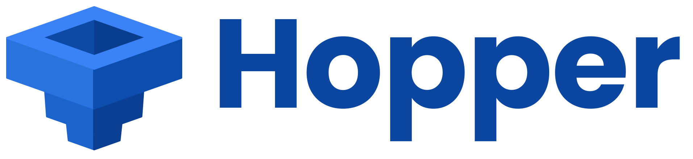
  </picture>
</p>

<h3 align="center">Discover, slice, print.</h3>

<p align="center">
  Hopper for Klipper, Mainsail and Fluidd. By <a href="https://communitycad.dev">CommunityCAD</a>.
</p>

<p align="center">
  
  
  
  
  
</p>

<p align="center">
  <a href="#install"><b>Install</b></a> ·
  <a href="docs/guide/how-it-works.md">How it works</a> ·
  <a href="docs/guide/troubleshooting.md">Troubleshooting</a> ·
  <a href="CONTRIBUTING.md">Contributing</a>
</p>

---

Browse [CommunityCAD](https://communitycad.dev) models from inside Mainsail or Fluidd,
slice them on the printer with your own profiles, print, and share the result back. From
your phone, without a PC.

<p align="center">
  <a href="https://youtu.be/inJyThbF6EE">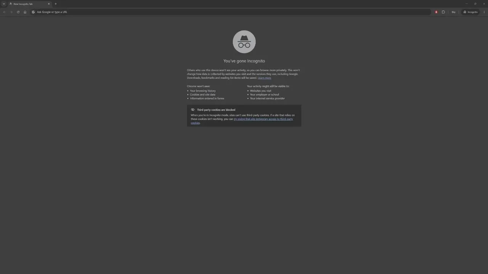</a>
  <br>
  <sub>Browse, link the printer, slice and print, sped up. <a href="https://youtu.be/inJyThbF6EE">Watch the demo on YouTube</a>.</sub>
</p>

## What it does

- **Discover.** Browse and search CommunityCAD models, with a "fits your printer" check
  against your build volume.
- **Slice.** Slice on the printer with OrcaSlicer, using your own material and print
  profiles. No PC needed.
- **Print.** Send a model or G-code to the printer, and start it after a confirm that checks
  the file was made for this printer and that the right material is loaded.
- **Share.** After a print, share its print profile and a post with a photo, publicly or
  kept private.

**Nothing in your printer's interface is changed.** Hopper doesn't fork or modify Mainsail
or Fluidd: nginx adds one `<script>` tag, and everything Hopper does happens inside that
script and a Moonraker component. Uninstalling returns the interface to stock, byte for byte.

**Status: beta**, with invited testers. Things will change, and feedback is very welcome.

## Screenshots

On a computer, inside Mainsail:

<table>
  <tr>
    <td width="50%" valign="top">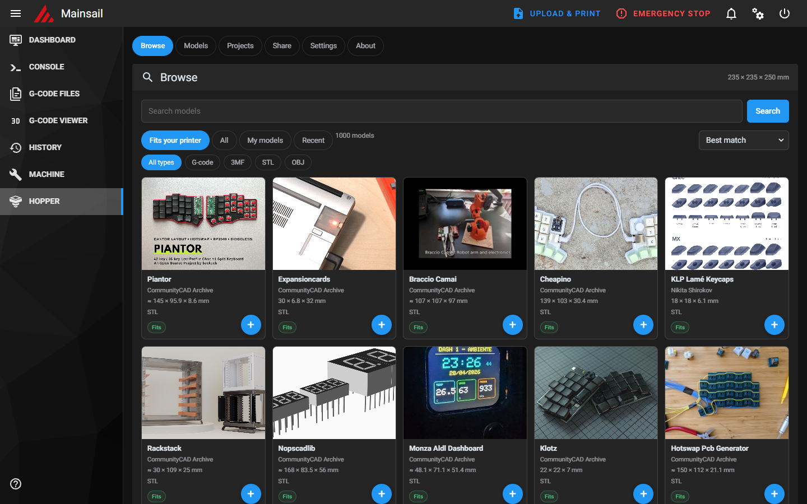<br><sub>Browse CommunityCAD, filtered to what fits your printer</sub></td>
    <td width="50%" valign="top">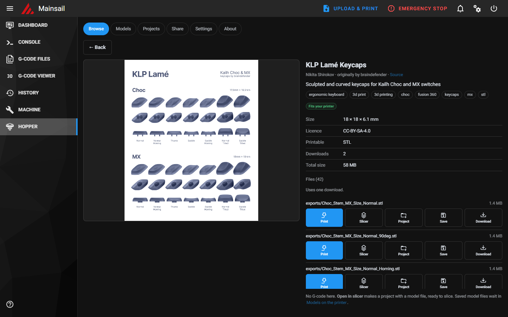<br><sub>A model: files, licence, and Print, Slice or Save</sub></td>
  </tr>
  <tr>
    <td width="50%" valign="top">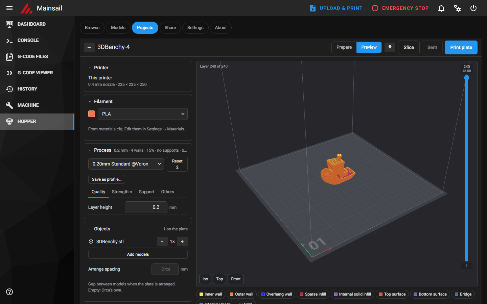<br><sub>Sliced on the printer: the layer preview, with your profiles</sub></td>
    <td width="50%" valign="top">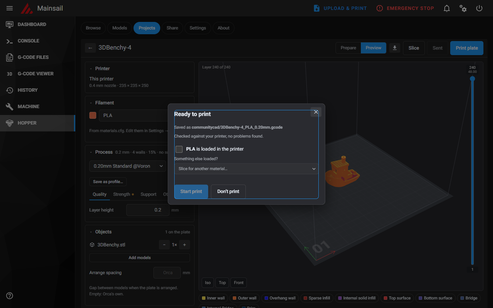<br><sub>Print confirm: checked against your printer and material</sub></td>
  </tr>
  <tr>
    <td width="50%" valign="top">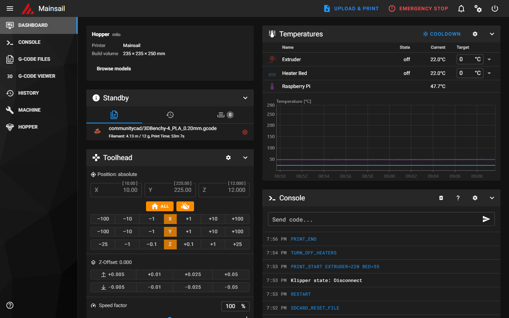<br><sub>Hopper's panel on the Mainsail dashboard</sub></td>
    <td width="50%" valign="top">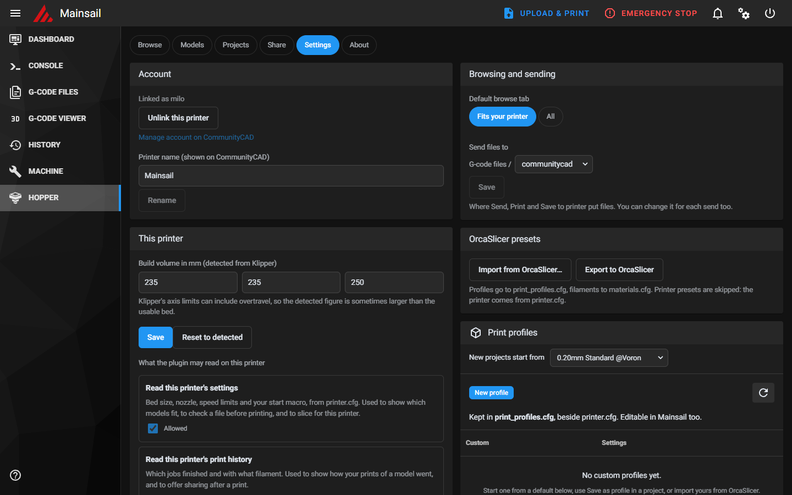<br><sub>Settings: account, this printer, profiles and materials</sub></td>
  </tr>
</table>

And on a phone:

<p align="center">
  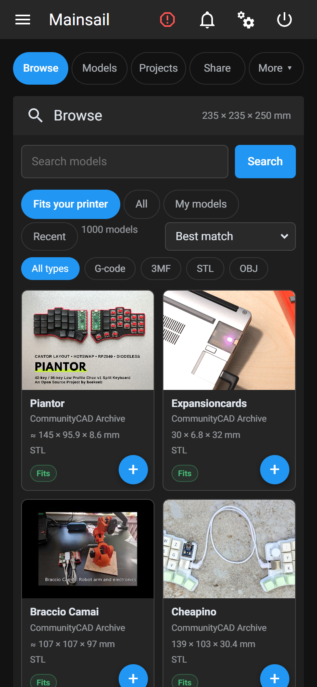
  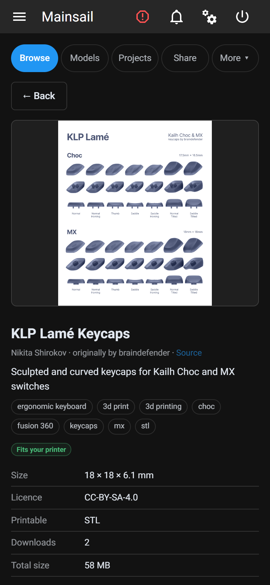
  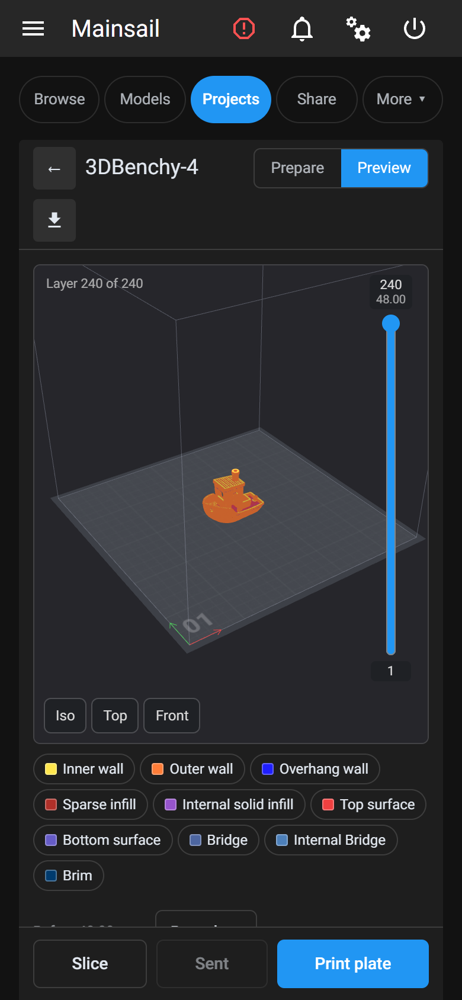
  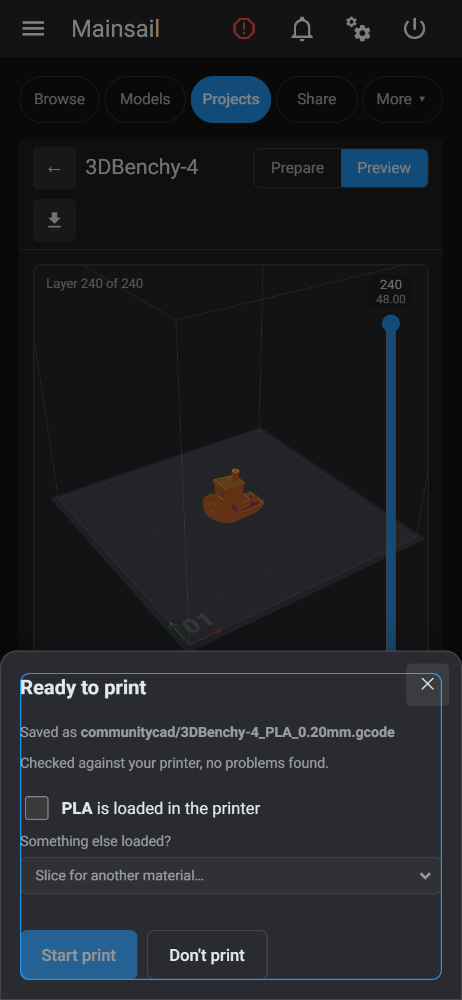
</p>

## Install

On the printer's Raspberry Pi, over SSH, as your normal user (not root):

```bash
bash <(curl -fsSL https://github.com/CommunityCad-dev/Hopper/releases/latest/download/install.sh)
```

That downloads the latest release into `~/hopper` and runs `scripts/install-all.sh`.
It needs only `curl` and `python3`, which every Klipper Pi already has.

<p align="center">
  <a href="https://youtu.be/_CVanOha9q8"></a>
  <br>
  <sub>A full install, at 2× speed. <a href="https://youtu.be/_CVanOha9q8">Watch on YouTube</a>.</sub>
</p>

<details>
<summary>Rather read it before you run it?</summary>

Download the release, look through it, then run the installer yourself:

```bash
cd ~ && wget https://github.com/CommunityCad-dev/Hopper/releases/latest/download/hopper.zip
unzip hopper.zip -d hopper && cd hopper
scripts/install-all.sh
```

The one-line installer is [`scripts/web-install.sh`](scripts/web-install.sh), attached to
each release as `install.sh`.
</details>

Use a release, not a `git clone`: a checkout of the source has no built interface
(that's made at release time), and the installer's check says so.

The installer sets up Hopper **and** slicing on the printer (OrcaSlicer, run headless on the
Pi), so you can pick a model on your phone, slice it with your own profiles and print it,
with no PC. It checks your device first and changes nothing until you've seen the result:

```
Hopper:
  ✓ nginx with sub_filter
  ✓ mainsail site: /etc/nginx/sites-available/mainsail
  ✓ Moonraker: 1 instance(s)
Slicing on the printer (OrcaSlicer 2.4.2):
  ✓ 64-bit OS (arm64)
  ✓ OrcaSlicer's libraries available from apt
  ✓ 7645 MB of memory
  ...
```

`scripts/install-all.sh --check` runs only the check (or, before downloading anything
by hand, `bash <(curl -fsSL https://github.com/CommunityCad-dev/Hopper/releases/latest/download/install.sh) --check`). If your device can run Hopper
but not the slicer, it says why and offers Hopper on its own.

**What slicing on the printer needs:** 64-bit Raspberry Pi OS (OrcaSlicer has no 32-bit
build), about 700 MB free, and 2 GB of memory or more (1 GB slices small models only).
Tested on a Pi 4 with Debian 13 (trixie).

**The three ways to install**

| Script | Installs | Needs sudo for |
|---|---|---|
| `scripts/install-all.sh` | Hopper and slicing on the printer, after a compatibility check. **Start here.** | nginx, and OrcaSlicer's libraries |
| `scripts/install.sh` | Hopper only: browse, send G-code made elsewhere, share | nginx |
| `scripts/install-orca.sh` | Slicing on the printer, added to an existing install | OrcaSlicer's libraries |

**To uninstall**, the same one-liner with `--uninstall`:

```bash
bash <(curl -fsSL https://github.com/CommunityCad-dev/Hopper/releases/latest/download/install.sh) --uninstall
```

It runs `scripts/uninstall.sh`, which removes everything the install added, then deletes
`~/hopper`. It keeps the printer's link and settings, so a reinstall doesn't need a new
link; add `--purge` to remove those too. `scripts/install-orca.sh --remove` removes just
the slicer.

<p align="center">
  <a href="https://youtu.be/6xyuDwNRh9w"></a>
  <br>
  <sub><code>--uninstall --purge</code>, at 2× speed. <a href="https://youtu.be/6xyuDwNRh9w">Watch on YouTube</a>.</sub>
</p>

## Use at your own risk

This plugin comes with no warranty (see [LICENSE](LICENSE), sections 15 and 16).

- Models and G-code on CommunityCAD are made by other people. CommunityCAD doesn't check
  them for safety, and a file made for another printer can damage yours.
- The checks the plugin shows (printer match, fit) are aids, not guarantees.
- You are responsible for your printer. Watch every print, especially the first layer.
- The plugin never flashes firmware, never edits `printer.cfg`, and sends no commands to
  your printer other than starting or queueing a file you chose.

Accounts on CommunityCAD are Google or GitHub sign-ins; there are no passwords. A printer is
linked by approving a short code from your phone or computer, so nothing is typed on the printer.

The installer shows this and asks before changing anything (`--accept` skips the question
for scripted installs). The plugin asks once more, per printer, before its first send.

**What install changes**, and uninstalling removes:

- an nginx include in your Mainsail or Fluidd site, plus two snippet files (backed up first);
- a `[communitycad]` section in `moonraker.conf`, and the component linked into Moonraker;
- files under `~/communitycad` (the UI, OrcaSlicer if installed);
- with `--purge` only: `~/printer_data/communitycad` (settings, the printer's link token)
  and the backups in `~/communitycad`. The printer stays listed in your CommunityCAD
  account until you remove it there.

Your own files are kept on uninstall: `~/printer_data/models`, `~/printer_data/projects`,
and `materials.cfg` / `print_profiles.cfg` beside `printer.cfg`.

## Feedback

In the plugin, **More → About → Feedback**: pick Bug, Feature request,
Enhancement or General, and it opens a new issue here with your text filled in,
for you to check and send. You can also [open an issue](../../issues/new/choose)
directly.

## Layout

```
component/       Moonraker component: holds the token, talks to CommunityCAD, slices
web/             the injected UI (Preact + TypeScript + Vite)
nginx/           the sub_filter snippets
scripts/         install, uninstall, health check and release scripts
dev/             the component's unit tests and their fixtures
docs/guide/      install, how it works, troubleshooting
```

## Building the UI

Needs Node 20.19 or newer. Nothing is built on the printer at install time.

```bash
cd web
npm ci
npm run typecheck
npm run build      # writes web/dist/inject.js, fails if over the 200 KB gzipped budget
```

## Contributing

Issues and pull requests are welcome. See [CONTRIBUTING.md](CONTRIBUTING.md) for how
they're handled and how to run the tests.

## Licence

GPL-3.0-or-later: you can use, change and share Hopper, and changed versions you share
must stay open under the same licence. See [LICENSE](LICENSE) and [NOTICE](NOTICE).

The licence covers this plugin only. CommunityCAD itself is a separate, closed-source
platform; using its API is governed by the CommunityCAD API terms.
